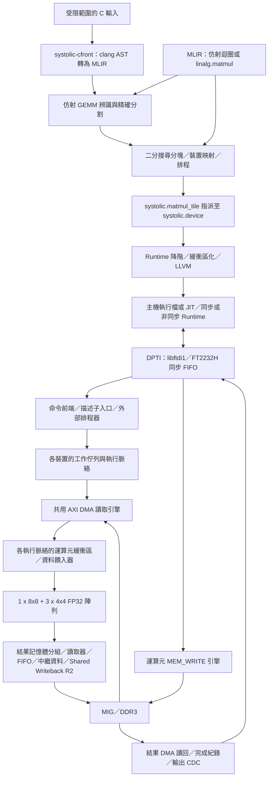

# Systolic-MLIR

## 專案簡介

**研究成果快照：`main`，2026-10-25。** 本專案整合 MLIR 編譯器與主機端 Runtime，
將 GEMM 映射至由固定幾何尺寸 FP32 Systolic Array 組成的異質加速器群。
目前硬體平臺為 **Digilent Nexys Video / Artix-7 XC7A200T**，包含
**一顆 8×8 與三顆 4×4 陣列**、以 DDR3 為後端的 DMA，以及
**DPTI（FT2232H USB 同步 FIFO）**通訊介面。

本研究探討如何將矩陣運算分割至不同幾何尺寸的陣列，同時考量歸約容量、Pipeline
相依性與共用傳輸資源。較大的分塊可降低呼叫額外成本；較小的陣列則可處理邊界，
並提供額外的平行運算能力。編譯器選擇空間分塊與裝置，依各種幾何尺寸的緩衝區容量
分段執行 K 維度歸約，並產生已排程的 Runtime 呼叫。Runtime 負責預先配置與傳送
運算元、比對完成紀錄；FPGA 的執行脈絡負責執行工作，並共用記憶體與結果讀回引擎。

完整的 C 至 FPGA 流程請先參閱 [REPRODUCE.md](REPRODUCE.md)。
本 README 區分實作與驗證證據：已納入版本控制的 **2026-10-25 Shared Writeback R2
映像具有實板 PASS 結果**，但建置時含未提交變更的原始碼快照並不完整，因此這些結果
**不能用來認定目前工作目錄重新建置的版本已通過驗證**。本次 README 文件稽核
未執行 FPGA 建置或實板測試。

## 主要功能與證據層級

「已實作」表示 `main` 中已有程式碼；「已驗證」必須註明驗證層級。
「實驗性」表示功能適用範圍受限，或尚未完成完整驗證。「未知／尚未重新驗證」
不代表測試失敗。PASS 表示指定測試通過，FAIL 表示測試失敗，UNKNOWN 表示
目前證據不足以判定，不能視為 FAIL。

| 功能 | 實作狀態 | 驗證範圍 |
|---|---|---|
| 靜態形狀 FP32 `linalg.matmul` → 異質分塊 | 已實作 | 編譯器迴歸測試；封存實板 E2E 結果具有下述編譯器來源限制 |
| 仿射 GEMM 辨識、精確分割與運算元檢視 | 已實作，適用範圍受限 | [規格與參考判定測試](docs/AFFINE_GEMM_MAPPING.md)；未全面驗證所有可辨識形式的實板執行 |
| 裝置選擇、二分搜尋分塊、可變 K 分段歸約與排程 | 已實作 | [編譯器測試](test/Systolic)；封存實板測試涵蓋部分編譯產生的工作負載 |
| 以硬體校準的運算成本 | 已實作 | 歷史 fold RTL 的實板校準；見[來源追溯](docs/PROVENANCE.md)與[迴歸測試點](test/Systolic/cost_model_fold_rtl.mlir) |
| 加速器群 Cost Model V2，包含 Shared Writeback R2 | 已實作，為預設搜尋模型 | [REPRODUCE.md](REPRODUCE.md) 記錄 R2 特定不變量檢查與 31 個精確 RTL 差異比對案例 PASS；尚未建立目前版本的完整掃描與實板總完成時間校準證據 |
| DPTI、外部排程器、DMA/AXI/MIG/DDR3 | 已實作 | 封存 R2 映像已有實板數值執行驗證；目前原始碼重新建置的版本尚未重新驗證 |
| 佇列深度 4、同步與非同步 Runtime、完成紀錄配對 | 已實作 | 封存同步測試 26/26、非同步測試 52/52、壓力測試 2,560/2,560 筆工作 PASS |
| Shared Writeback R2 | 已實作 | 封存實板數值測試 PASS；內部記憶體分組重用、仲裁公平性與 AXI 錯誤案例僅有較受限的 RTL 驗證證據 |
| PE 層級的資料饋入與歸約重疊 | 實驗性效能能力 | 已有 RTL 測試平台；封存資料中沒有直接實板觀測或已證明的實板加速效益 |
| 以完整 beat 寬度傳送的 v2 運算元路徑 | 實驗性 | 已有 RTL 驗證路徑；正式封存的 R2 映像使用 **v1** |
| 在工作運算元填入完成前開始串流運算 | 此執行路徑尚未支援 | 運算啟動須等待運算元到齊；工作 Pipeline 不等於串流運算 |
| 精確重建已驗證 R2 映像的原始碼與建置產物 | 進行中／尚未重新驗證 | `RTL_TREE_DIRTY=1`；缺少包含完整未提交變更的原始碼快照 |
| NCHW Conv2D、專用 `linalg.batch_matmul` 卸載、通用逐元素運算／池化 | 目前 main 的 GEMM 流程未支援 | 早期分支成果屬於歷史紀錄；仿射批次 GEMM 辨識是另一項功能 |

## 系統架構



編譯器各節點實作於 [Transforms](lib/Systolic/Transforms)，共用的編譯流程建構程式位於
[SystolicPipelines.cpp](lib/Systolic/Transforms/SystolicPipelines.cpp)。
主機傳輸實作位於 [dpti_ftdi.cpp](runtime/dpti_ftdi.cpp)。FPGA 模組連接位於
[systolic_dma_top.sv](rtl/multi_200t/tile_pipelined/dma/systolic_dma_top.sv)、
[執行脈絡](rtl/multi_200t/tile_pipelined/dma/systolic_accel_context.sv)與
[排程器](rtl/multi_200t/tile_pipelined/scheduler)。
此圖呈現執行與資料路徑，不表示每個階段均同時執行，也不表示目前陣列由編譯器
產生的 bitstream 實作。正式使用的陣列是採用 Xilinx 浮點 IP 的手寫 RTL。

## 編譯器流程

[Systolic Dialect](include/Systolic/SystolicOps.td) 以 `systolic.device` 描述硬體，
以 `systolic.matmul_tile` 描述單次呼叫。另包含 `systolic.dma`，以及早期的
`pe_array`、`stream`、`mac` 抽象表示。裝置屬性描述幾何尺寸、K 容量、運算額外成本
與傳輸／Pipeline 成本；僅有 Dialect 宣告，不代表實體硬體的 Runtime 已支援該功能。

| 階段 | 目前 CLI／實作 | 介面契約 |
|---|---|---|
| 目標宣告 | `--systolic-declare-fpga-fleet` | 當輸入未宣告目標時，加入支援的實體加速器群；K 與 Pipeline 選項須符合預定組態 |
| 仿射辨識與映射 | `--affine-matmul-to-systolic` | 辨識仿射乘加巢狀迴圈、檢查合法性，並將支援區域分割為已排程分塊 |
| Linalg 映射 | `--systolic-binary-search-tile-matmul` | 空間分解、裝置指派、排程，以及依各裝置容量分段執行 K 維度歸約 |
| Runtime 降階 | `--lower-systolic-matmul-tile-to-fpga` | 檢查 FP32、裝置映射、排程、分塊尺寸及實體 K 容量；產生同步呼叫或非同步提交／等待呼叫 |
| 主機 LLVM 降階 | `--systolic-runtime-to-llvm` | 跨函式邊界的緩衝區化、記憶體釋放，以及 affine/memref/SCF/arith／控制流程／函式至 LLVM 的轉換 |
| 整合 Linalg 流程 | `--systolic-fpga-pipeline` | 二分搜尋映射 → Runtime 降階 → LLVM 降階 |

獨立的 `--systolic-tile-matmul`、`--systolic-select-device`、
`--systolic-cost-analysis`、`--systolic-schedule-overlap` 與
`--systolic-materialize-schedule` Pass 仍可用於編譯器實驗；
並非每個 Pass 都是整合流程中額外執行的階段。

一個 `matmul_tile` 是**一顆裝置的一次呼叫**：`m ≤ rows`、`n ≤ cols`、
`1 ≤ k ≤ k_max`。邊界列／行採補零處理。較長的歸約會拆成多次呼叫，並由主機端
將結果累加至 C：目前 FPGA GEMM 基本運算單元沒有 C-in 連接埠。裝置 ID 固定為：
`@acc_8x8_0` → 0；`@acc_4x4_0`、`@acc_4x4_1`、`@acc_4x4_2` → 1、2、3。
`start_cycle` 與 `est_cycles` 描述運算時間軸，並非實測的端到端延遲。
硬體排程器可延後運算啟動，直到其由忙碌狀態控制計數的週期計數器到達 `start_cycle`；
USB 資料抵達時間與運算元就緒狀態也會限制實際執行時機。

仿射辨識不只支援標準三層迴圈矩陣乘法，但並非通用 C 最佳化器。
精確映射、覆蓋範圍、相依性檢查，以及支援的批次／檢視形式，詳見
[AFFINE_GEMM_MAPPING.md](docs/AFFINE_GEMM_MAPPING.md)。診斷會區分
`PROVEN_VALID`（已證明有效）、`PROVEN_INVALID`（已證明無效）、`UNKNOWN`（尚無法判定）
與 `VALID_BUT_LOWERING_UNSUPPORTED`（有效但降階尚未支援）。無法判定的轉換保留在主機端。
浮點運算重新結合須明確允許（`systolic-cc --fp-reassociation` 或 Pass 的
`allow-fp-reassociation` 選項）；記憶體別名關係必須證明安全，或由使用者明確提供假設。
對於程式中已寫出的、以最小值截短邊界的分塊，MLIR 路徑提供辨識與還原未分塊迴圈的功能；
`systolic-cfront` 不會轉譯 `min`。

### 成本模型

[CostModel.cpp](lib/Systolic/Transforms/CostModel.cpp) 提供 V1 單次呼叫成本。
運算項為 `k + rows + cols - 2 + H`；**H=95** 來自歷史 fold 硬體，並非端到端 DMA
擬合值。目前加速器群的常數，包括歸約間距 69 與資料饋入間隔 26，集中定義於
[FpgaFleet.h](include/Systolic/FpgaFleet.h)。

[CostModelV2.cpp](lib/Systolic/Transforms/CostModelV2.cpp) 逐週期模擬共用資源的加速器群：
工作接納、運算元 DMA、執行脈絡 Pipeline、R2 結果資源、寫回仲裁、完成／讀回與輸出排空。
V2 為二分搜尋的預設模型；仍可選用 V1（Pass 選項使用 `cost-model=v1`，
`systolic-cc` 使用 `--cost-model v1`）。規劃總完成時間、預測裝置總完成時間與
主機實際經過時間是不同的量測量。

歷史上包含 1,782 份工作清單的 V2 差異比對研究，詳見
[COSTMODEL_V2.md](docs/COSTMODEL_V2.md)。其中固定優先權寫回的描述早於 R2：
**目前 R2 採循環輪詢仲裁**。R2 行為應以
[R2 差異比對驗證程式](eval/cost_model_v2/validate_r2.py)、
[不變量檢查](eval/cost_model_v2/check_r2_invariants.py)與目前程式碼為準。
歷史重播與特定的 31 案例結果，都不足以證明目前版本的完整掃描覆蓋率。
實板 MIG 延遲／更新、主機／USB 提交速度，以及適用情況下的排程器等待，仍未納入
完整校準的預測；共用讀取參考值 3.51 words/cycle 並非在此 R2 映像上實測。

## FPGA 硬體架構

[tile_pipelined](rtl/multi_200t/tile_pipelined) 與
[heterogeneous_fleet](rtl/multi_200t/heterogeneous_fleet) 均有目前使用的建置流程，
目標元件為 `xc7a200tsbg484-1`。封存 R2 映像屬於 `tile_pipelined`；
目前 R2 成本模型測試平台則建置 `heterogeneous_fleet`。
不能僅憑這些名稱認定目前原始碼與封存映像的建置來源完全相同。

- **運算：** FP32 乘法／加法 IP、輪替式累加器記憶體分組與歸約邏輯，
  採輸出駐留式分段歸約執行。幾何尺寸於合成時固定；工作實際 K 值可小於合成的 K 容量。
- **記憶體：** 板上 512 MiB DDR3，透過 MIG 與 128 位元 AXI DMA 存取。
  共用且帶有標籤的讀取引擎供應各執行脈絡的運算元緩衝區。
  此處 DMA 為 Repository 內的 RTL，並非宣稱使用了 Xilinx AXI DMA 產品 IP。
- **控制：** DPTI 描述子入口與外部硬體排程器供應四個執行脈絡。
  每個執行脈絡預設具有四筆工作的佇列；頂層另以 `RB_DEPTH=8` 限制已接納但尚未讀回的結果。
  Runtime 可提交額度使用組態中的 `PIPELINE_DEPTH`；這些是不同的資源限制。
- **Shared Writeback R2：** 各執行脈絡的快照記憶體分組、結果讀取器、FIFO 與中繼資料佇列，
  將結果擷取與 DDR 完成解耦。有效負載與中繼資料提交後即可釋放結果記憶體分組；
  工作完成仍須等待 DDR 寫入回應。單一共用 AXI 寫入引擎以循環輪詢方式授權已提交的分塊，
  並保留擁有者直到最後一筆回應；該擁有者可有多筆尚未完成的突發傳輸。
  寫入錯誤會隔離該執行脈絡直到重設；目前沒有對外逐筆回報工作 DDR 錯誤狀態的協定。
- **重疊執行：** 運算元填入、資料饋入／歸約、入列、寫回與讀回均有 Pipeline 機制。
  實際重疊取決於工作就緒狀態、緩衝區所有權與鏈路速率。有限次實板數值測試 PASS，
  不足以證明硬體上的同時計算、提早重用記憶體分組、多筆未完成 DDR 寫入或公平性。

v1 路徑會在運算開始前填入運算元。RTL 已提供以完整 beat 寬度載入的 v2 運算元路徑，
以及 PE 層級重疊實驗，但兩者均不構成正式使用版本已驗證的串流運算。
分階段開發歷程請參閱 [ASYNC.md](docs/ASYNC.md)；其中較早的「實板 NOT RUN（未執行）」
敘述僅適用於各該實驗，不會推翻後續封存 R2 的實板結果。

## Runtime 與 DPTI 通訊

由 CMake 建置的 Runtime 包含 [dpti_runtime.c](runtime/dpti_runtime.c)、
[dpti_ftdi.cpp](runtime/dpti_ftdi.cpp)、
[fpga_matmul_tiled.cpp](runtime/fpga_matmul_tiled.cpp) 與
[fpga_async_runtime.cpp](runtime/fpga_async_runtime.cpp)。

1. 將分塊打包為交錯配置、八通道寬的運算元資料區塊，包含必要補齊；
   透過 FT2232H 同步 FIFO 鏈路，以 `MEM_WRITE` 傳送至 DDR。
2. 傳送描述子暫存器的 `WRITE32` 封包，包含工作／裝置 ID、維度、排程與位址；
   最後才寫入 CONTROL/submit。
3. FPGA 的入口／排程器／執行脈絡邏輯擷取運算元、執行陣列運算、將結果寫入 DDR，
   並將讀回工作排入佇列。
4. 讀取 16 位元組完成紀錄與實體結果分塊。非同步工作以 `job_id` 配對至主機管理的
   GEMM 群組；結果依 K 分段歸約順序累加，再複製至使用者的輸出。

同步 API 為 `fpga_matmul_tiled_auto_scheduled`。非同步 API 使用
`fpga_gemm_begin`、`fpga_tile_submit` 與 `fpga_gemm_wait`，提供有限提交額度，
並分階段儲存運算元與結果。當指定組態的映像支援完成紀錄時，`systolic-matmul` 與
`systolic-cc` 會自動選擇非同步模式；`run_e2e.sh` 則明確選擇模式，預設為同步。

請將 `SYSTOLIC_FPGA_CONFIG` 設為與**目前載入映像**相符的檔案。
剖析器會驗證 K 容量、支援的 1+3 加速器群、完成紀錄標頭、DDR 容量與 Pipeline 深度，
並由 K 容量推導運算元資料區塊大小。R2 封存組態指定 K8/K4=16/16、1,024 位元組資料區塊、
完成紀錄與深度 4。來源追溯欄位與 SHA 中繼資料不是 Runtime 對已載入 FPGA 的身分證明：
DPTI 沒有讀取組態暫存器的協定。因此，剖析 PASS 僅證明主機接受該組態。
必須搭配使用相符的映像、組態與封存雜湊值。

當卸載不受支援或失敗時，`systolic-cc` 可能退回 CPU 執行；
僅憑程式結束狀態不足以證明 FPGA 曾執行，必須檢查執行報告。
`systolic-matmul` E2E 測試框架則會明確回報派送失敗。
整數值測試以精確 CPU 參考結果檢查 FP32 硬體，不代表與任意逐項 FP32 加總均逐位元一致，
也不代表已完整涵蓋 IEEE 特殊值行為。

## 建置與執行

請從 Repository 根目錄執行指令。目前支援的重現工具鏈為
**LLVM/MLIR 24 建置目錄 + clang 24**，另需 CMake、Ninja、C/C++17 主機編譯器、
`pkg-config` 與 `libftdi1` 開發檔案。舊文件中的 LLVM 18 指令屬於歷史流程，
無法建置目前這套重現流程。共同模擬需要 Verilator ≥5；由原始碼建置 FPGA／燒錄
需要 Vivado 2026.1 與 Digilent 開發板定義檔，僅建置編譯器則不需要。

```bash
# 請替換為實際的 LLVM/MLIR 24 與 clang 24 路徑。
LLVM24_BUILD_DIR=/path/to/llvm24/build
CLANG24=/path/to/clang24
bash scripts/reproducibility/build.sh \
  --llvm-build "$LLVM24_BUILD_DIR" --clang "$CLANG24"
```

等效的組態設定與建置指令如下：

```bash
cmake -G Ninja -S . -B build \
  -DCMAKE_C_COMPILER=gcc -DCMAKE_CXX_COMPILER=g++ \
  -DLLVM_DIR="$LLVM24_BUILD_DIR/lib/cmake/llvm" \
  -DMLIR_DIR="$LLVM24_BUILD_DIR/lib/cmake/mlir" \
  -DSYSTOLIC_CFRONT_CLANG="$CLANG24"
cmake --build build
```

預設建置包含 `systolic-opt`、`systolic-cost`、`systolic-cfront`、`systolic-cc`、
`systolic-matmul`、Runtime 測試與 FPGA Runtime 靜態函式庫。
JIT 工具需要 MLIR ExecutionEngine 與 `mlir_c_runner_utils` 支援。

僅檢查編譯器，不存取 FPGA：

```bash
build/bin/systolic-opt test/Systolic/matmul.mlir \
  --convert-matmul-to-systolic="rows=8 cols=8"
build/bin/systolic-opt --systolic-select-device test/Systolic/select_device.mlir
```

對於已具備相符加速器群宣告的靜態 FP32 Linalg 模組：

```bash
build/bin/systolic-opt --systolic-fpga-pipeline input.mlir
# 目標映像支援完成紀錄時，可使用非同步降階：
build/bin/systolic-opt --systolic-fpga-pipeline="async=true" input.mlir
```

沒有硬體時，可先使用軟體 Runtime 編譯隨附的 C 範例；
此流程檢查編譯器與軟體執行，不驗證 FPGA 行為：

```bash
build/bin/systolic-cc --runtime soft --fp-reassociation \
  test/reproducibility/gemm_example.c -o /tmp/systolic-gemm-example
/tmp/systolic-gemm-example
```

### 建置 bitstream（選用；耗時）

此流程**僅由原始碼建置**，不會燒錄，也不表示已通過驗證。
請安裝 Digilent Nexys Video 開發板定義
`digilentinc.com:nexys_video:part0:1.2`；Tcl 會搜尋
`$HOME/work/vivado/vivado-boards/new/board_files`。
兩個流程的 MIG XCI 與相鄰 PRJ 目前都位於各自的 **`dma/ip/ddr3/`**；
浮點加法／乘法 IP 位於各自的 `ip/fp32/`。

```bash
VIVADO=/path/to/Vivado/bin/vivado
BUILD_TCL=rtl/multi_200t/tile_pipelined/dma/dma_top_build.tcl
# 另一個選項：rtl/multi_200t/heterogeneous_fleet/dma/dma_top_build.tcl
# 請選擇尚未使用的標籤，以保留先前專案的輸出。
SYSTOLIC_PROJ_TAG=r2_new_experiment \
SYSTOLIC_PLACE_DIRECTIVE=ExtraTimingOpt \
SYSTOLIC_ROUTE_DIRECTIVE=Explore \
  "$VIVADO" -mode batch -source "$BUILD_TCL" \
  -tclargs build v1 16 16 1 1 3
```

位置參數依序為 `mode variant K8 K4 n_inv NUM_8X8 NUM_4X4`。
K8/K4 設定合成時的歸約容量，不是矩陣維度；`n_inv` 是早期硬體啟動測試的次數，
不是外部工作數。v1 接受十進位 1..16376；v2 要求至少為 16，且為 8 的倍數。
Tcl 接受其他非空的加速器群數量組合，但正式主機 Runtime 僅支援 1×8×8 + 3×4×4。

輸出位於 `$HOME/work/vivado/<flow>/systolic_dma_<variant>_k8_<K8>_k4_<K4>_<NUM_8X8>x8x8_<NUM_4X4>x4x4_<tag>`。
重複使用標籤可能輪替／取代先前專案輸出。預設佈局策略為 `AltSpreadLogic_high`，
繞線策略為 `Explore`；封存映像使用 `ExtraTimingOpt` / `Explore`。
`SYSTOLIC_PROJ_TAG`、`SYSTOLIC_PLACE_DIRECTIVE`、`SYSTOLIC_ROUTE_DIRECTIVE`、
選用的 `SYSTOLIC_INCR_REF` 與 `DPTI_CLK_PHASE` 均由 Tcl 處理。
務必明確指定 **`build`**：省略模式時預設為 `all`（建置並燒錄），
而指定專案標籤時不允許使用 `all`。

**兩份目前的 Tcl 腳本均已恢復 `read` 與 `sweep` 模式入口，
但尚未重新驗證這些驗證程序。** 它們仍保留早期 VIO 假設；
`read_vio` 會呼叫 `arm_run`，`sweep` 則重複此操作。
請勿將這些入口用作外部排程器映像的正式數值驗證方法。
過時註解與 REPRODUCE.md 仍描述這些模式會被拒絕；數值測試應使用 Runtime／E2E。

### 燒錄封存 FPGA 映像

燒錄是獨立且明確的硬體操作。下列指令不會建置 bitstream：

```bash
bash scripts/reproducibility/run_board.sh verify-program  # 僅檢查雜湊值
bash scripts/reproducibility/run_board.sh program         # 燒錄封存映像
```

`verify-program` 檢查的是本機檔案，不是開發板已載入的映像。
實板包裝腳本會固定使用封存映像／組態，清除衝突的傳輸設定，
並忽略從環境繼承的 `SYSTOLIC_FPGA_CONFIG`。
若要測試新建置版本，請直接使用 E2E 測試框架，並指定該版本的組態。

### 執行實板 E2E

燒錄相符封存映像，並確保 USB 介面未被其他程序占用後：

```bash
bash scripts/reproducibility/run_board.sh check
bash scripts/reproducibility/run_board.sh e2e --quick --mode sync
bash scripts/reproducibility/run_board.sh e2e --regression --mode async
bash scripts/reproducibility/run_board.sh c test/reproducibility/gemm_example.c
```

對新建置並已燒錄的映像，請明確指定實際組態，並使用新的結果目錄
（測試框架可能清除自己先前產生的輸出）：

```bash
SYSTOLIC_FPGA_CONFIG=/path/to/new/impl_1/fpga_config.txt \
  bash test/e2e/run_e2e.sh --backend board --mode async --regression \
  --out /tmp/systolic-new-image-e2e
```

## 測試與驗證

以下為實驗重現入口，**不是本次 README 改寫已執行的測試**。
實驗請使用新的輸出位置。詳細前置需求、模式隔離、結果判定與問題排除，
請參閱 [REPRODUCE.md](REPRODUCE.md)。

| 層級 | 執行入口 | 可建立的驗證證據 |
|---|---|---|
| 編譯器與單元／參考判定迴歸測試 | `cmake --build build --target check-systolic` | 透過 lit/FileCheck 檢查 Dialect 驗證、映射／合法性、整數格、成本／排程、C 前端與軟體 Runtime |
| 僅主機端組態測試 | `cmake --build build --target check-e2e-config` | 不使用開發板，檢查剖析器與拒絕行為 |
| R2 資源／模型不變量 | `python3 eval/cost_model_v2/check_r2_invariants.py --tool build/bin/systolic-cost` | 模型不變量、仲裁、回應錯誤處理與排空行為 |
| R2 RTL 單元測試 | `python3 rtl/multi_200t/tile_pipelined/dma/tb/run_shared_wb_r2.py unit /tmp/systolic-r2-unit` | 結果讀取器／FIFO／寫回路徑與引擎測試（Icarus/vvp） |
| R2 執行脈絡／加速器群模擬 | 使用同一腳本，指定 `context`、`fleet`、`pipeline` 或 `legacy`，並使用新的輸出目錄 | 透過 Verilator 測試記憶體分組、Pipeline、共用寫回與部分錯誤／背壓案例 |
| 完整成本模型掃描 | `python3 eval/cost_model_v2/run_validation.py --out /tmp/systolic-cost-full` | 多種 K／運算元路徑的模擬研究；工作量明顯高於特定 R2 驗證 |
| Runtime 同步／非同步實板測試 | 上述實板 E2E 指令 | 僅驗證已載入映像的 DPTI／Runtime／數值執行 |

使用 lit 前，請安裝 `lit`，並確保 LLVM 24 的 `FileCheck`、`count` 與 `not` 可用；
若無法自動偵測 lit，請設定 CMake 的 `LLVM_EXTERNAL_LIT`。
測試數量會隨工具可用性與版本而變動，本 README 不沿用過時的固定數量作為目前覆蓋率。

特定 R2 差異比對測試使用 **`heterogeneous_fleet` RTL** 與
`eval/cost_model_v2/tb_fleet_jobs_r2.sv`：

```bash
JOBS=2 bash eval/cost_model_v2/build_bench.sh 16 16 v1 /tmp/systolic-r2-bench
python3 eval/cost_model_v2/validate_r2.py \
  --bench /tmp/systolic-r2-bench/obj/tbrun --out /tmp/systolic-r2-results
```

此測試比對逐筆工作事件、資源狀態轉換、AXI 交握與主機輸出排空。
壓力測試重播可將觀測到的外部匯流排輸入提供給模型；這是差異比對驗證，
不是對實板 DDR 時序的獨立預測。

沒有 FPGA 時，可建置並執行實際主機程式／Runtime，與 Verilator 共同模擬：

```bash
bash scripts/reproducibility/build.sh --cosim
bash scripts/reproducibility/run_cosim.sh e2e --quick --mode sync
bash scripts/reproducibility/run_cosim.sh e2e --quick --mode async
bash scripts/reproducibility/run_cosim.sh c test/reproducibility/gemm_example.c
cmake --build build --target check-e2e-cosim-regressions
```

共同模擬以通訊端橋接取代 libftdi，並對 Xilinx 浮點 IP、MIG/DDR3 與元件基本單元建模。
預設測試目前工作目錄的 RTL；`RTL_REV`、`RTL_DIR`、`USE_V2` 與 K 覆寫值可改變輸入。
此流程不能認證封存的含未提交變更映像，也不能驗證電氣／時序行為。
模式 F 的傳輸失敗注入僅供模擬使用：實板顯示 **NOT APPLICABLE（不適用）**是預期行為，
不是 FAIL。數值不符、Runtime 錯誤、逾時與未執行案例，必須保留不同的判定結果。

### 截至 2026-10-25 的驗證證據紀錄

目前預設封存版本為
[Shared Writeback R2，K8=K4=16](artifacts/fpga/tile_pipelined/1x8x8-3x4x4/2026-10-25-k8_16-k4_16/README.md)。
其 bitstream SHA-256 為：

```text
bd8aba7212a24347eba1dc497204dd6eb5117e8a8ff77094fd94c496a41f3db5
```

| 產物／實驗 | 紀錄狀態 | 可追溯證據與限制 |
|---|---|---|
| R2 實體實作 | PASS：時序與 DPTI I/O 檢查關卡通過 | [繞線後時序報告](artifacts/fpga/tile_pipelined/1x8x8-3x4x4/2026-10-25-k8_16-k4_16/systolic_dma_top_timing_summary_routed.rpt)、[DPTI 檢查關卡](artifacts/fpga/tile_pipelined/1x8x8-3x4x4/2026-10-25-k8_16-k4_16/dpti_io_summary.txt)；時序結論以 XDC 假設成立為條件 |
| R2 實板壓力測試 | PASS：2,560/2,560 筆工作，數值不符為零 | [封存概覽](artifacts/fpga/tile_pipelined/1x8x8-3x4x4/2026-10-25-k8_16-k4_16/README.md)與[硬體報告](artifacts/fpga/tile_pipelined/1x8x8-3x4x4/2026-10-25-k8_16-k4_16/hardware-report.md)；四顆裝置均測試完整分塊，另涵蓋混合／交錯工作負載與完成紀錄配對 |
| R2 同步實板快速測試 | PASS：26/26，與 CPU 比對 1,068 個輸出元素，不符為零 | [同步測試摘要](artifacts/fpga/tile_pipelined/1x8x8-3x4x4/2026-10-25-k8_16-k4_16/hardware-validation/sync-quick/summary.txt)與硬體報告 |
| R2 非同步實板迴歸測試 | PASS：52/52，與 CPU 比對 15,875 個輸出元素，不符為零 | [非同步測試摘要](artifacts/fpga/tile_pipelined/1x8x8-3x4x4/2026-10-25-k8_16-k4_16/hardware-validation/async-regression/summary.txt)與硬體報告 |
| 由上述實板案例認定目前編譯器版本完全通過驗證 | NOT ESTABLISHED（尚未建立證據） | 封存報告指出 Runtime 測試由 R2 工作目錄編譯，但編譯器驅動案例使用另一個工作目錄的編譯器，其成本模型支援不同 |
| 目前原始碼建置與新 FPGA 映像 | NOT YET REVALIDATED（尚未重新驗證） | [REPRODUCE.md §6.1 與目前檢查紀錄](REPRODUCE.md)：僅匯入／組態預檢 PASS；該次審查未建立合成、實作、繞線後檢查關卡與新映像實板測試的通過證據 |
| 目前 R2 成本模型特定檢查 | 紀錄為 PASS：不變量 + 31 個精確差異比對案例 | [REPRODUCE.md 目前檢查紀錄](REPRODUCE.md)；重用既有 RTL 測試平台執行檔，該次審查未重新建置測試平台，也未校準實板總完成時間 |
| 早期編譯器／共同模擬執行 | 歷史 PASS | [REPRODUCE.md §15](REPRODUCE.md) 記錄附日期的 lit、全新建置、C 範例與同步／非同步共同模擬結果；不是本次工作目錄的新執行結果 |

封存組態記錄 `RTL_GIT_REV=229fe2431c0c72d25e6654a88e8e5d47c697301b`
與 **`RTL_TREE_DIRTY=1`**。未封存完整的未提交差異修補檔／原始碼快照；
僅取出該版本不足以重建已驗證映像。原始紀錄含歷史絕對路徑，
未包含執行檔與產生的編譯器 IR。測試框架也明確指出：硬體幾何尺寸依組態檔信任，
而非獨立查詢硬體確認。

已納入版本控制的 `.bit`、`.ltx`、組態、報告與紀錄均予保留，不受全域忽略規則影響。
請在封存目錄中檢查完整性：

```bash
(cd artifacts/fpga/tile_pipelined/1x8x8-3x4x4/2026-10-25-k8_16-k4_16 && sha256sum -c SHA256SUMS)
```

檢查碼 PASS 證明檔案完整性；預檢 PASS 證明專案匯入成功；模擬 PASS 證明模型環境中的執行；
實板 PASS 僅適用於其特定映像與工作負載。重新建置會產生新產物，必須另行驗證。

## 專案目錄結構

| 目錄 | 用途 |
|---|---|
| [include/Systolic](include/Systolic) | Dialect TableGen、Pass／模型／分析介面，以及實體加速器群常數 |
| [lib/Systolic](lib/Systolic) | IR 驗證、仿射分析／分割、最佳化器、成本模型與降階 Pass |
| [tools](tools) | `systolic-opt`、`systolic-cost`、`systolic-cfront`、`systolic-cc`、`systolic-matmul`、早期 HLS 轉譯器與分析工具 |
| [runtime](runtime) | 目前 DPTI 同步／非同步 Runtime；`lib/`、`tests/`、`harness/`、`attic/` 保留早期 UART/im2col 研究 |
| [rtl/multi_200t/tile_pipelined](rtl/multi_200t/tile_pipelined) | 陣列核心、排程器、DMA/DPTI 整合、模擬測試平台與 Vivado 流程 |
| [rtl/multi_200t/heterogeneous_fleet](rtl/multi_200t/heterogeneous_fleet) | 相關加速器群 RTL／建置流程；目前 R2 成本模型差異比對測試平台的目標 |
| `rtl/multi_200t/{tile_pipelined,heterogeneous_fleet}/dma/ip/ddr3/` | 各流程的 MIG XCI 與相鄰 DDR3 PRJ；兩者均不再使用舊的頂層 `ip/ddr3/` 位置 |
| [test](test) | lit 編譯器／前端／軟體測試、辨識測試集，以及 Runtime 與實板／共同模擬 E2E 測試框架 |
| [eval](eval) | 成本模型驗證、排程／組態／K 容量／重疊研究，以及歷史評估證據 |
| [artifacts/fpga](artifacts/fpga) | 納入版本管理的 FPGA 映像、組態、報告、檢查碼與硬體驗證證據 |
| [scripts/reproducibility](scripts/reproducibility) | 環境／建置、明確燒錄封存映像，以及實板／共同模擬包裝腳本 |
| [docs](docs) | 映射規格、成本模型、非同步／E2E 歷程、K 維度研究與來源追溯 |
| [hls](hls) | 早期 HLS 硬體產生原型與報告 |

## 研究進度與已知限制

目前已實作的研究貢獻包含：異質靜態 GEMM 映射、具合法性診斷的精確仿射辨識／分割、
依硬體特性建構的成本估計，以及整合編譯器／Runtime／DDR 後端 FPGA 的工作執行路徑。
R2 封存資料已建立加速器群在紀錄工作負載上的硬體數值運算與同步／非同步提交證據。

待完成工作包括：從原始碼精確重現映像、目前工作目錄版本的完整驗證、更廣泛的 FP32
數值測試、共用記憶體與端到端成本的實板校準，以及內部重疊與仲裁的直接量測。
主機鏈路與 v1 運算元寫入器可能主導執行時間；佇列占用量與主機工作執行緒的重疊計數器，
不能量測 PE 是否同時活動。

目前限制包含：僅支援特定靜態 GEMM 形狀／檢視、明確的浮點轉換合法性要求、
固定的主機裝置映射，以及工作之間沒有實體運算元廣播／快取重用。
不可推論已支援任意動態迴圈、任意 `linalg.generic`、池化、專用 NCHW/`batch_matmul`
Pass、PCIe 或完整串流運算。這些仍是可能的擴充方向，並非已完成的功能。
有限次壓力測試成功，不構成在所有情況下均不會死結的證明。

## 歷史研究成果

早期 **Arty A7-35T 4×4 HLS/UART** 原型、HLS C 轉譯路徑
（`--convert-matmul-to-systolic`、`--expand-pe-array-to-mac`、`systolic-translate`）、
Nexys UART/fold 實驗、浮點精度研究與 NHWC im2col Runtime 均保留為有價值的研究歷程。
請參閱 [HLS 4×4](hls/gemm_4x4/README.md)、
[早期 Runtime 清單](runtime/lib/README.md)與[來源追溯](docs/PROVENANCE.md)。
NHWC `--conv2d-to-fpga` Pass 仍存在，但其早期 Runtime 並未納入目前由 CMake 建置的
DPTI Runtime 函式庫。歷史卷積 CSV 記錄 48/48 逐位元一致結果；PROVENANCE.md
記載尚未解決的映像／協定歸屬衝突，因此不能將這些結果歸屬於目前 R2 加速器群。

先前 README 亦記錄 `torch-mlir-integration` 分支上的 torch-mlir/NCHW Conv2D 與
batch-matmul 實驗，包括記錄為 75/75 的批次測試結果。
這些保留為歷史分支報告，不代表已稽核確認的 main 分支支援或目前硬體驗證結果。
歷史資源／時序／ULP 數據屬於各自設計，不得套用至 R2。

## 實驗重現方式與文件判讀原則

[REPRODUCE.md](REPRODUCE.md) 是詳細流程的主要來源，涵蓋前置需求、環境隔離、
工具鏈建置、封存驗證、明確燒錄操作、C 執行、共同模擬與附日期的結果。
[E2E.md](docs/E2E.md)、[ASYNC.md](docs/ASYNC.md)、[COSTMODEL.md](docs/COSTMODEL.md)、
[COSTMODEL_V2.md](docs/COSTMODEL_V2.md) 與 [PROVENANCE.md](docs/PROVENANCE.md)
提供介面契約與開發歷程。

部分章節早於目前 main：REPRODUCE.md 的 heterogeneous-fleet MIG 路徑與
read/sweep 拒絕描述已過時；較早的 E2E／非同步實板狀態，以及 V1/V2 固定優先權描述，
均僅適用於特定版本。發生衝突時，應以目前 Tcl／RTL／Runtime 與本文件引用的
附日期、對應特定映像的證據為準。應保留歷史 PASS 結果，但未執行相應測試前，
不得將結果延伸至新映像或目前工作目錄的確切版本。
